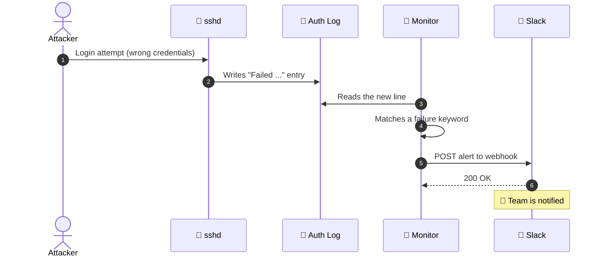
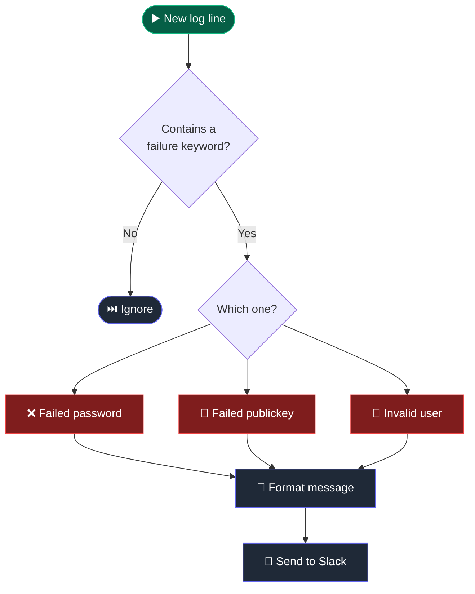
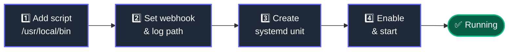
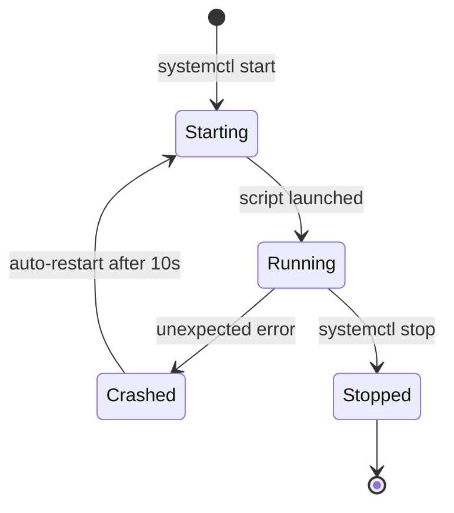

# SSH Security Monitor for Slack

>  Real-time Python service that watches your Linux auth logs and pings Slack the moment someone fails to log in over SSH.


---

## 🧭 How It Works


---

## ⏱️ What Happens During an Attack



---

## 🔍 Detection Logic



---

## 🚀 Quick Install



**Requirements:** Linux · Python 3 · `pip install requests` · root/sudo

### 1️⃣ Add the script

```bash
sudo nano /usr/local/bin/ssh_monitor.py
sudo chmod +x /usr/local/bin/ssh_monitor.py
```

### 2️⃣ Configure

Set `WEBHOOK_URL` and pick the right `LOG_FILE` for your distro:

| Distro | `LOG_FILE` |
|---|---|
| 🎩 RHEL · CentOS · Fedora · Amazon Linux | `/var/log/secure` |
| 🟠 Ubuntu · Debian | `/var/log/auth.log` |

### 3️⃣ Create the service

```bash
sudo nano /etc/systemd/system/ssh-monitor.service
```

```ini
[Unit]
Description=SSH Security Monitor for Slack Alerts
After=network.target

[Service]
Type=simple
User=root
ExecStart=/usr/bin/python3 -u /usr/local/bin/ssh_monitor.py
Restart=always
RestartSec=10

[Install]
WantedBy=multi-user.target
```

### 4️⃣ Start it

```bash
sudo systemctl daemon-reload
sudo systemctl enable --now ssh-monitor.service
```

---

## ♻️ Service Lifecycle



---

## 🧰 Cheat Sheet

| Action | Command |
|---|---|
| 📊 Status | `sudo systemctl status ssh-monitor` |
| 📜 Live logs | `sudo journalctl -u ssh-monitor -f` |
| 🔄 Restart | `sudo systemctl restart ssh-monitor` |
| ⏹️ Stop | `sudo systemctl stop ssh-monitor` |

---
